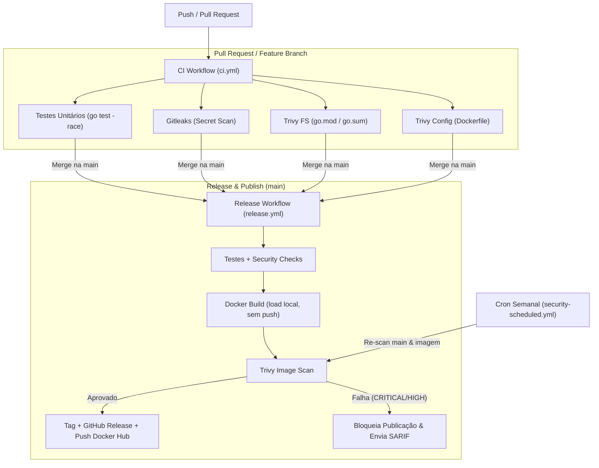

# Plano de Implementação: Pipeline DevSecOps (Gitleaks & Trivy)

Este documento descreve o planejamento para integrar práticas e ferramentas de **DevSecOps** ao repositório `homelab-telemetry-api`, utilizando **Gitleaks** (detecção de segredos) e **Trivy** (análise de vulnerabilidades em dependências, Dockerfile e imagens de container).

---

## 1. Contexto Atual do Repositório

- **Stack:** Go `1.26.0` (`go.mod` com dependências como `go-chi/chi/v5`, `shirou/gopsutil/v3`, `k8s.io/client-go`, `joho/godotenv`).
- **Containerização:** Multi-stage `Dockerfile` usando `golang:1.26-alpine` (build) e `alpine:3.21` (runtime) com usuário não-privilegiado (`appuser:appgroup`).
- **CI (`.github/workflows/ci.yml`):** Executa `go test -v -race ./...` e validações de segurança (Gitleaks + Trivy FS/Config) em Pull Requests para `main` e pushes em outras branches.
- **CD/Release (`.github/workflows/release.yml`):** Em pushes na `main`, executa testes, checks de segurança e build+scan da imagem Docker **antes** de criar a tag Git, GitHub Release e publicar no Docker Hub.

---

## 2. Objetivos da Implementação

1. **Shift-Left Security:** Detectar segredos expostos, dependências Go vulneráveis e más configurações no `Dockerfile` já durante o desenvolvimento e em Pull Requests.
2. **Container Security Gate:** Impedir que imagens Docker com vulnerabilidades críticas/altas (com correção disponível) sejam publicadas no Docker Hub ou recebam tags de release.
3. **Visibilidade e Rastreabilidade:** Centralizar achados de segurança via SARIF no GitHub Security (*Code scanning alerts*) com baixo índice de falsos positivos.

---

## 3. Arquitetura do Pipeline

---

## 4. Detalhamento das Ferramentas

### 4.1. Gitleaks (Secret Scanning)
- **Escopo:** Código-fonte, arquivos de configuração e histórico de commits do Git (`fetch-depth: 0`).
- **Riscos mitigados:** Vazamento acidental de tokens do Docker Hub, tokens do GitHub, `kubeconfig`, chaves privadas ou arquivos `.env` reais.
- **Configuração:** `.gitleaks.toml` na raiz estendendo as regras padrão (`useDefault = true`), com `allowlist` para `.env.example` e `go.sum`.
- **Execução:** `gitleaks/gitleaks-action@v2` (repositório público).

### 4.2. Trivy (SCA, Misconfiguration & Image Scan)
O Trivy cobre três camadas distintas usando `aquasecurity/trivy-action@v0.36.0`:

| Modo | Alvo | O que detecta | Onde roda |
| :--- | :--- | :--- | :--- |
| **`trivy fs`** | `go.mod`, `go.sum` | CVEs conhecidas nas bibliotecas Go | `ci.yml`, `release.yml`, `security-scheduled.yml` |
| **`trivy config`** | `Dockerfile` | Más práticas de build/container | `ci.yml`, `release.yml`, `security-scheduled.yml` |
| **`trivy image`** | Imagem Docker gerada | CVEs no SO base (Alpine) e nos pacotes/binário Go | `release.yml` (antes do push), `security-scheduled.yml` |

- **Política de bloqueio:**
  - Severidades: `CRITICAL,HIGH` com `exit-code: '1'`.
  - `ignore-unfixed: true` (ignora vulnerabilidades sem patch oficial disponível).
  - Exceções documentadas no arquivo `.trivyignore`.
  - Upload de relatórios SARIF para a aba *Security > Code scanning alerts* via `github/codeql-action/upload-sarif@v3`.

---

## 5. Decisões Definidas para o Projeto

1. **Repositório público:** Habilita uso gratuito de `gitleaks-action@v2` e upload de relatórios SARIF para o GitHub Security.
2. **Critério de bloqueio no Trivy:** Bloquear apenas `CRITICAL` e `HIGH` com `ignore-unfixed: true`.
3. **Ordem no `release.yml`:** Build e scan da imagem Docker executam **antes** da criação da tag Git, GitHub Release e push para o Docker Hub.
4. **Hardening do `Dockerfile`:** Versões das imagens base fixadas em `golang:1.26-alpine` e `alpine:3.21`.
5. **Versionamento:** Plano mantido em `docs/devsecops-plan.md`.
